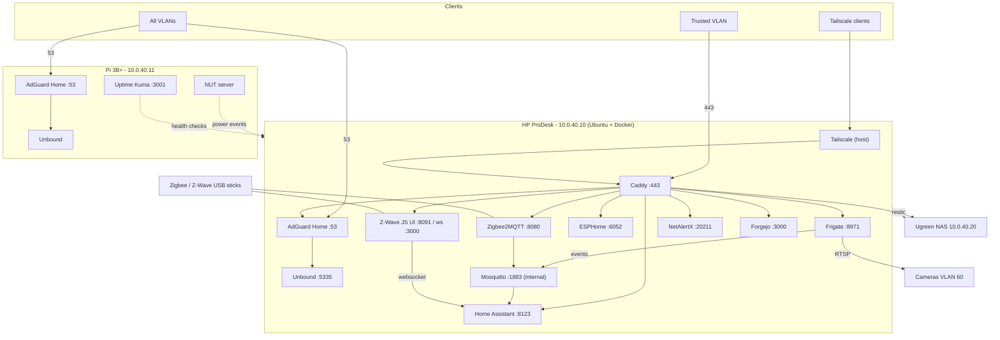

# Home Server and Services Architecture

| | |
|---|---|
| **Document** | Home server, supporting nodes and self-hosted services |
| **Companion** | `network-architecture.md` (VLANs, firewall, physical layout) |
| **Version** | 2 (baseline after decision round, 2026-10-18) |
| **Rule** | Only decided items are in the baseline. Undecided items are in §19 (Pending decisions) and are **not** part of the design until decided. |

---

## 1. Overview

A single HP ProDesk 400 G4 mini PC in the office runs the household's infrastructure as Docker containers on Ubuntu Server LTS:

- filtered DNS (AdGuard Home + Unbound)
- HTTPS reverse proxy (Caddy)
- smart-home hub (Home Assistant Container) with Zigbee/Z-Wave
- camera recording with local AI detection (Frigate)
- device monitoring (NetAlertX)
- the configuration Git server (Forgejo)

Tailscale runs on the host for remote access. A Raspberry Pi 3B+ in the network closet provides the services that must survive a server outage: secondary DNS, secondary NTP, UPS signaling (NUT) and uptime checks. The office Ugreen NAS holds backups and file shares.

---

## 2. Principles

| # | Principle | Practice |
|---|---|---|
| S1 | Containers for apps, host for host jobs | Apps in Docker; SSH, Docker, Tailscale, NUT, updates and backups on the host |
| S2 | Config as files, files in Git | Service configs are text files deployed by Ansible from Forgejo; UI-only state is backed up |
| S3 | One front door | Only Caddy (443) and DNS (53) are reachable from client VLANs; SSH from admin devices |
| S4 | Local only (with Tailscale exception) | No vendor cloud features; downloads allowed |
| S5 | Separate data from code | Code is reproducible; data is backed up and restore-tested |
| S6 | Critical services survive the server | DNS, NUT and Uptime Kuma also run on the Pi |
| S7 | Least privilege | Per-app credentials, internal Docker networks, non-root where possible |

---

## 3. Hardware

| Role | Model | CPU | RAM | Storage | Network | Idle power | Notes |
|---|---|---|---|---|---|---|---|
| Home server | HP ProDesk 400 G4 DM (used) | i5-8500T, 6C/6T, Intel UHD 630 | 16 GB (2 slots, max 32 GB) | Internal SSD (confirm size) | 1 GbE | ~11–15 W | Confirm power brick included and BIOS password cleared before buying |
| Recording drive | 4 TB WD Purple + USB 3 enclosure | — | — | 4 TB | USB | ~5 W | 2.5-in bay too thin for 4 TB HDD |
| Secondary node | Raspberry Pi 3B+ + PoE HAT | 4× Cortex-A53 | 1 GB | Pending (§19 P5) | 10/100/1000 (~300 Mbps effective) | ~3–4 W | Powered and UPS-backed by closet switch |
| Storage | Ugreen NAS | — | — | — | — | — | Office, VLAN 40, 10.0.40.20 |

BIOS settings on the server: admin password set, virtualization on, **power-on after AC loss** enabled.

---

## 4. Host platform: Ubuntu Server LTS + Docker

| Host component | Runs on | Purpose |
|---|---|---|
| Ubuntu Server 26.04 LTS | Server | Base OS |
| Raspberry Pi OS Lite | Pi | Base OS |
| OpenSSH | Server, Pi | Key-only admin access; works when Docker is broken |
| Docker Engine + Compose | Server, Pi | Runs all app containers |
| Tailscale | Server host | Subnet router + server's own tailnet address; Tailnet Lock |
| NUT server | odin (office UPS), vidar (closet UPS) | USB link to the UPS that powers that host |
| NUT client | NAS | Own 5-minute on-battery shutdown timer (UGOS ignores NUT's shutdown signal); odin wakes it with Wake-on-LAN |
| unattended-upgrades | Server, Pi | Automatic OS security patches |
| chrony | Server, Pi | NTP server for all VLANs (the UCG Max serves none); NTS upstream, orphan mode, each other as fallback |
| restic (systemd timer) | Server | Nightly encrypted backups to NAS |
| nftables/ufw | Server, Pi | Allow 22 (admin sources), 53, 123/udp, 443 (server), Tailscale; deny rest |

**Not on the server:** UniFi controller (in UCG Max); OpenTofu/Ansible (run from the admin laptop).

---

## 5. Service topology



---

## 6. Service catalog

**Exposure key:** *Proxy* = only via Caddy on 443 · *LAN* = directly from allowed VLANs · *Internal* = Docker network / localhost only.

### 6.1 Home server

| Service | Function / purpose | Port(s) | Exposure | Config in Git | Persistent data |
|---|---|---|---|---|---|
| AdGuard Home | House DNS; ad/tracker/malware blocking; per-VLAN rules; blocked services; query logs; local rewrites | 53 TCP/UDP; web 80 | 53 LAN + tailnet; web Proxy | `AdGuardHome.yaml` (templated) | Query logs, stats |
| Unbound | Recursive resolver | 5335 | Internal | `unbound.conf` | — |
| Caddy | HTTPS front door; wildcard Let's Encrypt cert via DNS-01; routes by name | 80, 443 | LAN (Trusted) + tailnet | `Caddyfile` | Certificates |
| Home Assistant (Container) | Smart-home hub, automations, dashboards, notifications | 8123 | Proxy | `packages/*.yaml` | `.storage`, history DB |
| Mosquitto | MQTT bus (Frigate, Zigbee2MQTT → HA) | 1883 | Internal | `mosquitto.conf`, ACL | Retained messages |
| Zigbee2MQTT | Zigbee coordinator software | 8080 | Proxy (auth token) | `configuration.yaml` | Coordinator backup, DB |
| Z-Wave JS UI | Z-Wave controller software (S2) | 8091 web; 3000 ws | Web Proxy; ws Internal | settings | Keys, NVM backup |
| ESPHome | Local firmware for DIY devices | 6052 | Proxy | device YAML | Build cache |
| Frigate | NVR for 5 Amcrest cameras; AI detection via OpenVINO on UHD 630 | 8971 auth UI; 5000 internal; 8554 RTSP; 8555 WebRTC | 8971 Proxy; **5000 never exposed** | `config.yml` | Recordings on 4 TB USB HDD; event DB |
| NetAlertX | New/unknown device alerts | 20211 | Proxy | config | Device DB |
| Forgejo (+ Actions runner) | Private Git server for IaC; nightly drift checks | 3000 | Proxy | `app.ini` | Repositories |

Not deployed: DDNS updater (not needed with Tailscale); DNS sync tool (replaced by IaC push); local AI (deferred, §18).

### 6.2 Raspberry Pi 3B+

| Service | Function / purpose | Port | Exposure |
|---|---|---|---|
| AdGuard Home + Unbound | Secondary filtering DNS, identical config | 53 | LAN |
| NUT server | Closet UPS (APC BE600M1) via USB; shuts vidar down; readable by HA | 3493 | odin only |
| Uptime Kuma | Monitors server, services, gateway, internet; alerts if server is down | 3001 | Proxy |

### 6.3 Ugreen NAS

| Item | Design |
|---|---|
| Network | Office, VLAN 40, 10.0.40.20 |
| Web admin / apps | Published via Caddy (`nas.home.<domain>`); proxy accepts NAS's self-signed backend cert |
| File shares | SMB direct to `nas.home.arpa` from Trusted; remote via Tailscale route to 10.0.40.20 (admins) |
| Hardening | Ugreen cloud remote-access feature and UPnP **off**; NAS firewall allows web only from proxy + admin devices |
| Roles | restic backup target; UniFi backup copies; Forgejo mirror; media stack ([`media-stack/`](../media-stack/readme.md), Docker on the NAS, published on 10.0.40.20 and proxied by Caddy) |
| Power | Office UPS; NUT client of odin |

---

## 7. Configuration notes

### 7.1 AdGuard Home (both nodes)

| Setting | Value |
|---|---|
| Upstream | Local Unbound only |
| Private reverse DNS / conditional | `[/home.arpa/]10.0.40.1` and private reverse zones → gateway (its Servers-VLAN address) |
| Rewrite | `*.home.<domain>` → 10.0.40.10 |
| Clients | Defined by subnet: IoT strict · Trusted standard · Kids family filters + blocked services + safe search · Guest light · Work minimal |
| Cloud features | Browsing-security and parental-control **web services off** (they query AdGuard servers); use local lists |
| DoH defense | DoH-provider blocklist; Firefox canary domain |
| Sync | Ansible renders `AdGuardHome.yaml` from Git to both nodes; UI edits are overwritten on deploy |

### 7.2 Caddy

- Image built with the `caddy-dns/cloudflare` plugin; DNS-01 through a Cloudflare API token scoped to the `foxhound.nexus` zone (setup in the Docker runbook).
- Wildcard `*.home.<domain>` via DNS-01: no inbound ports; individual names never published.
- Routes: `ha.` → 8123 · `frigate.` → 8971 · `z2m.` → 8080 · `zwave.` → 8091 · `esphome.` → 6052 · `dns.` → AdGuard · `alerts.` → NetAlertX · `git.` → Forgejo · `unifi.` → gateway 10.0.40.1 · `nas.` → NAS :9443 · `status.` → Uptime Kuma (Pi) · media stack on the NAS: `qbittorrent.` `sabnzbd.` `prowlarr.` `sonarr.` `radarr.` `bazarr.` `jellyfin.` `seerr.` `ersatztv.`.

### 7.3 Home Assistant (Container)

- Automations/scripts/templates as YAML packages in Git; UI-configured integrations live in `.storage` (backed up).
- Integrations: MQTT, Z-Wave JS, ESPHome, UniFi device temps, NUT, Uptime Kuma.
- Mobile app reaches HA via Tailscale away from home; iOS push routes through Apple.

### 7.4 Zigbee2MQTT and Z-Wave JS UI

| Setting | Value |
|---|---|
| Zigbee network key / PAN IDs | `GENERATE` on first start |
| Permit join | Only while pairing (~1 min) |
| Install codes | Used where devices support them |
| Z2M frontend | Auth token; via proxy only |
| Z2M external JS extensions | **Disabled** (CVE-2026-71279) |
| Z-Wave security | S2 only; S2 Access Control for locks/garage; refuse S0 |
| Z-Wave controller | 800-series; firmware 7.22.1+; NVM backup before updates |
| Keys | SOPS-encrypted secrets; backed up offline |
| USB | `/dev/serial/by-id/...` mapped into containers |

### 7.5 Mosquitto

- `allow_anonymous false`; one user per client.
- ACLs: only Zigbee2MQTT and HA may write `zigbee2mqtt/bridge/request/#`; Frigate writes `frigate/#`.
- Not published on the host.

### 7.6 Frigate

| Setting | Value |
|---|---|
| Detector | OpenVINO on Intel UHD 630 (`/dev/dri`); no Coral |
| Cameras | 5× Amcrest 5MP; detect on substream ≤720p/5 fps; record main stream |
| Zones/masks | After mount locations are decided (§19 P3) |
| Retention | 7 days continuous + 30 days alerts/detections (tune to 4 TB) |
| Storage | 4 TB USB HDD mounted at `/mnt/recordings` |
| Access | 8971 via proxy; 5000 localhost only |
| Credentials | Low-privilege camera user (secret) |

### 7.7 NetAlertX

- Runs on the server (Pi 3B+ resources reserved for DNS/NUT/Uptime Kuma).
- Scans all VLANs from the Servers zone; imports the AdGuard client list.

### 7.8 Tailscale (host)

| Setting | Value |
|---|---|
| Install | Debian package on host |
| Subnet routes | 10.0.40.1/32 (gateway UI; it doesn't answer the server on 10.0.10.1), 10.0.40.10/32 (server: AdGuard answers `*.home.<domain>` with this address), 10.0.40.20/32 (NAS) |
| Tailnet Lock | On; sign new devices from a trusted node |
| Exit node | Off |
| DNS | Split DNS for `home.arpa` and `home.<domain>` → 10.0.40.10 (via the subnet route); override local DNS on |
| ACL policy | `group:admins` → 10.0.40.10 (22, 53, 443), gateway UI, NAS; `group:family` → 10.0.40.10 (53, 443) only |
| Key expiry | Disable expiry for the server node only |

---

## 8. Data flows

| Flow | Path |
|---|---|
| Name lookup | Device → AdGuard (server or Pi) → filter → Unbound → root/authoritative; `home.arpa` → gateway |
| Service access (home) | Browser → `*.home.<domain>` → Caddy 443 → service |
| Service access (away) | Phone → Tailscale → server → Caddy 443 (ACL-limited) |
| Camera event | Camera RTSP → Frigate → MQTT → Home Assistant → phone notification |
| Zigbee/Z-Wave | Radio → USB stick → Zigbee2MQTT (MQTT) / Z-Wave JS (ws) → HA |
| Power failure | Office: UPS → USB → odin NUT → NAS (client) shuts down, then odin. Closet: BE600M1 → USB → vidar NUT → vidar shuts down |
| Backup | restic nightly → NAS → monthly rotated USB copy |
| Config change | Laptop commit → Forgejo → `ansible --check` → apply |

---

## 9. Storage layout

| Path (server) | Contents | Backed up |
|---|---|---|
| `/srv/<service>/config` | Rendered configs (source in Git) | Yes (+ Git) |
| `/srv/<service>/data` | DBs, HA `.storage`, Z2M/Z-Wave state, Forgejo repos | Nightly |
| `/mnt/recordings` | Frigate recordings | No (events/clips yes) |
| Host configs | SSH, NUT, firewall, Tailscale | Via Ansible |
| NAS `/backups/restic` | Encrypted restic repository | Monthly USB copy |

---

## 10. Naming and certificates

| Space | Use | Example |
|---|---|---|
| `home.arpa` | DHCP hostnames | `nas.home.arpa` |
| `home.<domain>` | Services with trusted HTTPS | `ha.home.<domain>` |

`.local` is avoided (mDNS). `<domain>` is `foxhound.nexus` (Cloudflare Registrar and DNS); no `home` records are published.

---

## 11. Security

### 11.1 Host

| Control | Detail |
|---|---|
| SSH | Keys only (ed25519 / FIDO2); `PasswordAuthentication no`, `KbdInteractiveAuthentication no`, `PermitRootLogin no`, `AllowUsers <you>` |
| SSH reach | UniFi + host firewall: 22 from admin devices; Tailscale ACL: admins only |
| Break-glass | Local console with password |
| Patching | unattended-upgrades; weekly container update window |
| BIOS | Admin password; power-on after AC loss |

### 11.2 Containers and apps

| Control | Detail |
|---|---|
| Exposure | Only 53, 443 (+22 admin) reachable; other ports internal/localhost |
| Privileges | Non-root images where possible; device passthrough only for Frigate (`/dev/dri`) and radio sticks; no `--privileged` |
| Versions | Pinned image tags; release notes reviewed |
| Secrets | SOPS + age in Git; age key on laptop + offline copy |
| App auth | HA users; Z2M token; Z-Wave JS UI login; Frigate auth; MQTT per-user ACLs; AdGuard admin password |

### 11.3 Vulnerability watch list

| Component | Issue | Action |
|---|---|---|
| Zigbee2MQTT ≤ 2.12.0 | CVE-2026-71279 (CVSS 8): RCE via MQTT extension save (external JS + MQTT write) | Current release; external JS off; MQTT ACLs |
| Silicon Labs EmberZNet ≤ 9.0.2 | CVE-2026-47145–47154, CVE-2026-4526: crashes / OOB from malformed frames | Update coordinator firmware |
| Z-Wave 700/800 v7.21.1 | CVE-2024-50920 (fake node), 50921 (DoS), 50928 | Controller firmware 7.22.1+ |
| Z-Wave SDK ≤ 7.20.3 | CVE-2023-5310 DoS | Same |
| Z-Wave 500-series | CVE-2024-50930 RCE | Prefer 700/800 devices |
| Zigbee joining | Default trust-center key exposure | Short permit-join; install codes |
| Z-Wave S0 | Weak key exchange | S2 only |

---

## 12. Monitoring

| Signal | Source | Destination |
|---|---|---|
| Service health incl. server down | Uptime Kuma (Pi) | Notification |
| New devices | NetAlertX | HA notification |
| UPS state | NUT | HA + shutdown |
| Disk space (recordings, backups) | HA system monitor | HA alert |
| Backup success | restic → Uptime Kuma push monitor | Alert on miss |
| Config drift | Forgejo Actions nightly `--check` | Alert on diff |

---

## 13. Backup and recovery (availability Tier 1)

| Asset | Method | Frequency | Restore test |
|---|---|---|---|
| Container data | restic → NAS | Nightly | Quarterly |
| Home Assistant | Built-in backup + restic | Nightly | Quarterly |
| Z2M coordinator backup, Z-Wave NVM/keys | App backups + restic + SOPS | After changes | On hardware swap |
| AdGuard config | Git (both nodes deployed from it) | On change | — |
| Forgejo repos | restic + NAS mirror + laptop clone | Nightly | — |
| UniFi config | Gateway auto-backup → NAS | Daily | Once |
| Offline copy | Rotated USB of restic repo | Monthly | — |

**On server failure:** DNS continues on the Pi; remote access, HA, Frigate and proxy are down until the server is repaired or replaced and restored from backup (target: hours). No standby hardware.

---

## 14. Operations

| Task | Cadence |
|---|---|
| OS security updates | Automatic |
| Container updates | Weekly window |
| Coordinator/controller firmware | When security fixes ship (backup first) |
| Restore test | Quarterly |
| Log review (DNS, firewall, IDS) | Weekly |
| USB backup rotation | Monthly |
| CVE watch list review | Monthly |

---

## 15. Infrastructure as code

### 15.1 Tooling

| Layer | Tool |
|---|---|
| UniFi | Manual now; OpenTofu `ubiquiti-community/unifi` later |
| OS config (server, Pi) | Ansible |
| Services | Docker Compose via Ansible |
| Service configs | Templated files in Git |
| Secrets | SOPS + age |
| Git hosting | Forgejo on server; mirrors on NAS and laptop |
| Drift detection | Forgejo Actions runner (nightly) |
| Data | restic (backup, not code) |

### 15.2 Repository layout

```text
homelab/
├── tofu/
│   └── unifi/          # future state
├── ansible/
│   ├── inventory.yml   # server, pi, nas
│   ├── roles/          # base, ssh-hardening, docker, tailscale, nut, restic, adguard, unbound
│   └── site.yml
├── services/
│   ├── adguard/        # AdGuardHome.yaml.j2, unbound.conf
│   ├── caddy/          # Caddyfile, Dockerfile (DNS plugin)
│   ├── homeassistant/  # packages/, compose.yml
│   ├── mqtt/           # mosquitto.conf, acl
│   ├── zigbee2mqtt/
│   ├── zwave/
│   ├── esphome/
│   ├── frigate/        # config.yml
│   ├── netalertx/
│   └── forgejo/
├── tailscale/          # policy.hujson (ACLs)
├── secrets/            # *.sops.yaml
└── docs/               # architecture docs, runbook.md
```

### 15.3 Bootstrap order

1. Manual: Debian on server, Raspberry Pi OS on Pi, SSH keys.
2. From laptop: Ansible → base hardening, Docker, Tailscale, NUT, services.
3. Forgejo up; push repo; NAS mirror.
4. restic, Uptime Kuma push monitors, drift checks.
5. The laptop clone is the source of truth when the server is down.

---

## 16. Implementation plan

The Docker service layer is implemented in the repository's server/Pi Compose
stacks. See [the deployment runbook](runbook.md) for configuration, manual
first-run tasks, validation, and the explicitly separate host-provisioning work.
The Compose layer alone is not a completed production deployment.

| Step | Work |
|---|---|
| 1 | Buy/verify ProDesk; BIOS settings; Ubuntu Server LTS; SSH hardening |
| 2 | AdGuard + Unbound on server and Pi; DHCP DNS → both |
| 3 | Cloudflare token, CAA, DNSSEC; Caddy with wildcard cert |
| 4 | Mosquitto, Home Assistant, Zigbee2MQTT, Z-Wave JS UI, ESPHome |
| 5 | Frigate + USB drive; cameras on VLAN 60 |
| 6 | NetAlertX; NUT; Uptime Kuma |
| 7 | Tailscale on host; Tailnet Lock; ACLs; split DNS |
| 8 | restic to NAS; first restore test |
| 9 | Forgejo; configs into Git; SOPS; drift checks |

---

## 17. Decision log

| ID | Decision | Chosen | Date |
|---|---|---|---|
| D-S1 | Server hardware | HP ProDesk 400 G4 DM (used) | 2026-10-18 |
| D-S2 | Host platform | Ubuntu Server LTS + Docker (was Debian; changed at install) | 2026-11-05 |
| D-S3 | DNS filter | AdGuard Home (server + Pi) | 2026-10-18 |
| D-S4 | Reverse proxy | Caddy | 2026-10-18 |
| D-S5 | Home Assistant install | Container | 2026-10-18 |
| D-S6 | Recording storage | 4 TB USB HDD on server | 2026-10-18 |
| D-S7 | HTTPS | Own domain + Let's Encrypt wildcard (DNS-01) | 2026-10-18 |
| D-S8 | Availability | Tier 1: backups + restore tests | 2026-10-18 |
| D-S9 | DNS config sync | IaC push from Git | 2026-10-18 |
| D-S9b | Git hosting | Forgejo on server (+ NAS mirror, laptop clone) | 2026-10-18 |
| D-S10 | Pi role | Pi 3B+: DNS 2, NTP 2, NUT, Uptime Kuma; NetAlertX on server | 2026-10-18 |
| D-S11 | Local AI | Deferred | 2026-10-18 |
| D-S12 | Domain and DNS host | `foxhound.nexus` on Cloudflare Registrar + DNS; Let's Encrypt via `caddy-dns/cloudflare` | 2026-11-01 |
| D-S13 | Time service | chrony on server and Pi hosts as LAN NTP servers | 2026-11-01 |
| D-N1 | Remote access | Tailscale on host, Tailnet Lock, no exit node | 2026-10-18 |

---

## 18. Deferred (decided: not now)

| Item | Revisit when |
|---|---|
| Local AI (Ollama + Open WebUI, read-only MCP to HA/AdGuard) | Core stack stable |
| UniFi OpenTofu | After network is stable |
| Standby server (Tier 2) | If server downtime becomes a problem |

---

## 19. Pending decisions (not in baseline)

### P3 — Camera mount locations

- Deferred by choice. Needed for Frigate zones, masks and cable runs; doesn't block other work.

### P5 — Raspberry Pi 3B+ boot media

| Option | Pros | Cons |
|---|---|---|
| A. USB SSD (boot from USB) | Far more durable under constant DNS logging; faster | Small extra cost; USB boot setup on 3B+ |
| B. High-endurance microSD | Simplest; nothing extra | Still wears; failure takes down DNS 2 |

- **Mitigation either way:** reduce AdGuard query-log retention on the Pi.
- **Recommendation:** A.

---

## 20. References

- Zigbee2MQTT CVE-2026-71279 — https://www.sentinelone.com/vulnerability-database/cve-2026-71279/
- Silicon Labs EmberZNet CVEs — https://app.opencve.io/cve/?product=emberznet&vendor=silabs
- Silicon Labs Z-Wave SDK CVEs — https://app.opencve.io/cve/?product=z-wave_software_development_kit&vendor=silabs
- Z-Wave controller firmware guidance — https://github.com/kpine/zwave-js-server-docker/wiki/700-series-Controller-Firmware-Updates-(Linux)
- Used mini PC pricing (Sep 2026) — https://techfuelhq.com/homelab/best-mini-pcs-homelab-2026/
- Tailscale vs Headscale feature comparison — https://simeononsecurity.com/articles/tailscale-vs-headscale-comparison-guide/
