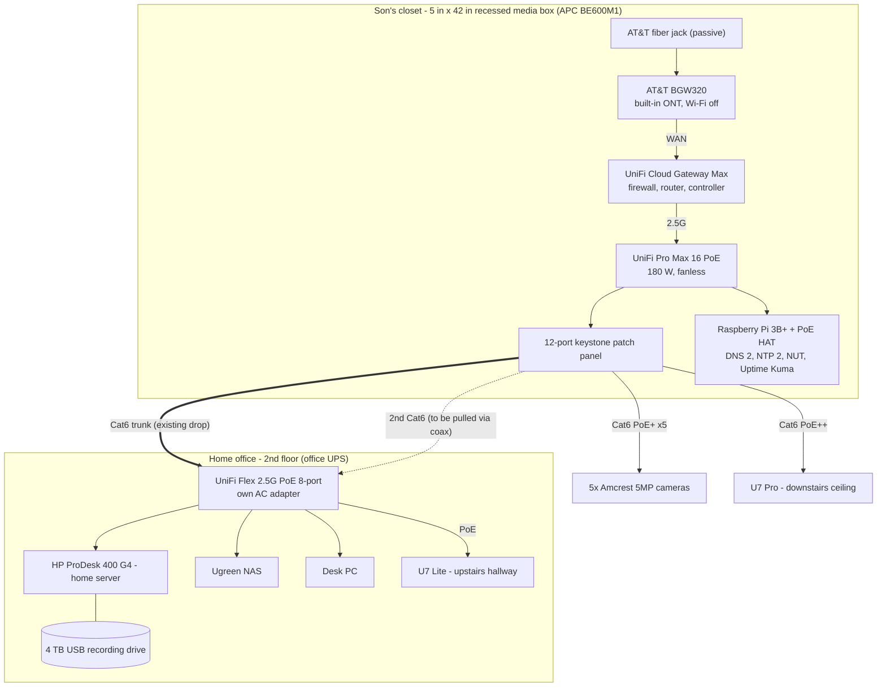
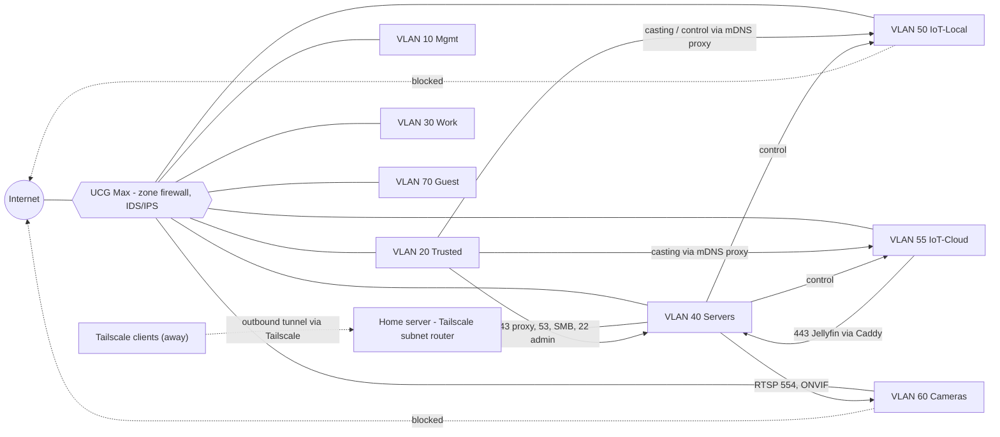
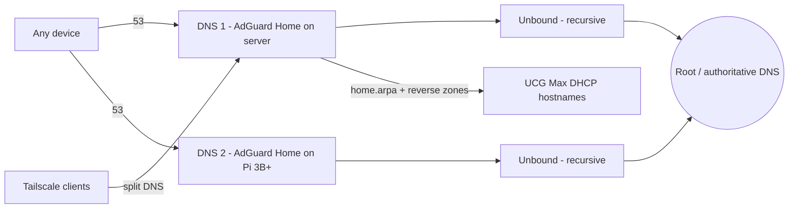

# Home Network Architecture

| | |
|---|---|
| **Document** | Home network architecture (physical, logical, security) |
| **Companion** | `home-server-architecture.md` (services, hosting, IaC) |
| **Version** | 3 (Wi-Fi compatibility decision and configuration runbook, 2026-10-19) |
| **Rule** | Only decided items are in the baseline. Undecided items are listed in §21 (Pending decisions) and are **not** part of the design until decided. |

---

**Implementation:** [UCG Max configuration runbook](ucg-max-runbook.md).

## 1. Overview

A segmented, locally managed home network that controls, isolates and secures every IP device in the house. Each class of device lives on its own VLAN behind a default-deny zone firewall on a UniFi Cloud Gateway Max. Network management is local only (no UniFi cloud account). Remote access uses hosted Tailscale, the one accepted cloud exception.

**In scope:** ISP hand-off, gateway/firewall, switching, Wi-Fi, VLANs, firewall policy, DNS, remote access, power, physical housing, security, monitoring, backup.
**Out of scope (see companion doc):** services on the home server, IaC repository details.

---

## 2. Principles and constraints

| # | Principle | Practice |
|---|---|---|
| P1 | No cloud, with one exception | UniFi uses a local admin with remote access off. **Exception:** Tailscale's hosted coordination server for remote access, hardened with Tailnet Lock. Downloads (firmware, blocklists, IDS rules) are acceptable. |
| P2 | No subscriptions | One-time hardware purchases. Accepted exception: annual domain registration (for trusted HTTPS). |
| P3 | Default deny | Every inter-VLAN flow is blocked unless listed in §9. |
| P4 | Zero inbound exposure | No port forwards. Tailscale connects outbound. UPnP off. |
| P5 | Local-first devices | Prefer Zigbee / Z-Wave / Matter-over-Thread / ESPHome / RTSP devices. Cloud-dependent devices are quarantined. |
| P6 | Single pane of glass | UniFi Network (built into the gateway) manages gateway, switches and APs. |
| P7 | Documented now, coded later | UniFi managed manually with rules documented in Git; OpenTofu `ubiquiti-community/unifi` provider is the future state. |
| P8 | Recoverable | Automatic config backups, copied off-device, restore-tested. |

---

## 3. Site and physical layout

| Location | What lives there | Notes |
|---|---|---|
| **Son's room closet**, wall facing the closet door | AT&T fiber entry, BGW320, gateway, PoE switch, patch panel, Raspberry Pi, UPS, coax entry | All in-wall cabling lands here; cables and fiber enter **from above**. Housed in a recessed media box (§13). |
| **Home office**, 2nd floor | Home server, Ugreen NAS, desk PC, 8-port office switch, upstairs AP feed, office UPS | Linked to the closet by one Cat6 trunk; a second Cat6 will be pulled using the existing coax as a pull line. |
| **Downstairs ceiling** | U7 Pro AP | Fed from the patch panel. |
| **Upstairs hallway ceiling** | U7 Lite AP | Powered directly by the office switch (one new short cable run). |
| **Exterior** | 5 Amcrest 5MP PoE cameras | Home runs to the patch panel. Mount locations: pending (§21). |

---

## 4. Physical topology

### 4.1 Pro Max 16 PoE port plan

| Port | Type | Connected to | Config |
|---|---|---|---|
| 1–5 | 1G PoE+ | Cameras 1–5 | Access, VLAN 60 |
| 6 | 1G PoE+ | Raspberry Pi 3B+ | Access, VLAN 40 |
| 7–12 | 1G PoE+ | Spare | — |
| 13 | 2.5G PoE++ | UCG Max LAN | Uplink; PoE off |
| 14 | 2.5G PoE++ | Office trunk (existing Cat6) | Native Mgmt 10; tagged 20/30/40/50/55/70 (includes upstairs SSIDs); **PoE off** (office switch has its own adapter) |
| 15 | 2.5G PoE++ | U7 Pro downstairs | Trunk (AP SSIDs) |
| 16 | 2.5G PoE++ | Second office link (after Cat6 pull) | Same trunk; spanning tree keeps one link active |
| SFP+ 1–2 | 10G | Unused | — |

### 4.2 Office switch (Flex 2.5G PoE 8-port) port plan

| Port | Connected to | Config |
|---|---|---|
| 1 | Trunk from closet | Uplink |
| 2 | Home server | Access, VLAN 40 |
| 3 | Ugreen NAS | Access, VLAN 40 |
| 4 | Desk PC | Access, VLAN 20 |
| 5 | U7 Lite (PoE out) | Trunk (AP SSIDs) |
| 6 | Second link from closet (after pull) | Uplink; spanning tree standby |
| 7–8 | Spare | Future Lab VLAN 80 nodes |

---

## 5. Logical topology

---

## 6. Device inventory

| Device | Model | Location | Role / purpose | Key configuration |
|---|---|---|---|---|
| Fiber jack | AT&T passive fiber jack | Closet (in box, top) | Fiber termination | None |
| ISP gateway / ONT | AT&T BGW320 (fiber straight in) | Closet (in box, top) | Built-in ONT, AT&T authentication | Wi-Fi off; IP passthrough to the UCG Max (D-N15). 7.8 × 3.9 × 7.5 in; mounted on its side in the 5-in box, temps monitored |
| Gateway / firewall / controller | UniFi Cloud Gateway Max (no storage) | Closet | Routing, zone firewall, IDS/IPS (2.3 Gbps), DHCP, UniFi Network controller | Local admin; remote access off; analytics off; firmware on a maintenance window; local auto-backups. 5.6 × 5 × 1.2 in, USB-C 5V/5A |
| Core PoE switch | UniFi Pro Max 16 PoE | Closet | Switching; PoE for cameras, downstairs AP, Pi | 180 W budget; wall-mount kit; 12.8 × 6.3 × 1.7 in |
| Office switch | UniFi Flex 2.5G PoE (8-port) | Office | Office access; powers U7 Lite | Own AC adapter on office UPS |
| AP downstairs | UniFi U7 Pro | Downstairs ceiling | Wi-Fi 7 incl. 6 GHz | SSIDs per §8 |
| AP upstairs | UniFi U7 Lite | Upstairs hallway ceiling | 2nd-floor Wi-Fi (2.4/5 GHz) | Powered by office switch |
| Patch panel | 12-port wall-mount keystone | Closet (in box, below ISP gear) | Terminate in-wall runs | ~10 × 2.6 × 2.75 in |
| Secondary infra node | Raspberry Pi 3B+ + PoE HAT | Closet (in box) | Secondary DNS, NTP server, NUT server, Uptime Kuma | VLAN 40, 10.0.40.11; 3B+ Ethernet tops out around 300 Mbps (ample for DNS) |
| UPS (closet) | APC BE600M1 (600 VA / 330 W) | Closet (in box, bottom) | Battery for BGW320, gateway, switch, and via PoE the cameras, U7 Pro and Pi | Wall-mount; USB → vidar (NUT); vidar shuts itself down, the rest runs until the battery ends. ~23 min at 100 W, so expect roughly 15–20 min at ~110–125 W |
| UPS (office) | CyberPower PR1500LCDRT2U (1500 VA) | Office | Server, NAS, office switch (and U7 Lite) | USB → odin (NUT server); NAS is odin's NUT client |
| Cameras | 5× Amcrest 5MP PoE (bullets + domes) | Exterior | Recorded and analyzed by Frigate | Configured offline: firmware updated, P2P/UPnP/cloud off, unique creds, substream ≤720p/5 fps, NTP → 10.0.40.10 (set manually) |
| Home server | HP ProDesk 400 G4 DM (i5-8500T, 16 GB) | Office | All services (companion doc) | VLAN 40, 10.0.40.10, Ubuntu 26.04 LTS + Docker |
| NAS | Ugreen | Office | File shares, backup target | VLAN 40, 10.0.40.20; Ugreen cloud remote access and UPnP off |
| Old smartphones | Various | Around house | HA wall panels, Wi-Fi survey, segmentation tester, offline 2FA backup | IoT-Local VLAN, no internet; charging cycled 30–80% |

---

## 7. IP addressing and VLANs

The UniFi default `192.168.1.0/24` is replaced **before** adopting devices (avoids clashes with the BGW320 LAN and with remote networks).

| VLAN | Name | Subnet | Gateway | DHCP | Internet | Purpose | Members |
|---|---|---|---|---|---|---|---|
| 10 | Mgmt | 10.0.10.0/24 | 10.0.10.1 | Reservations | Updates only | Infrastructure management | UCG Max, switches, APs |
| 20 | Trusted | 10.0.20.0/24 | 10.0.20.1 | Yes | Yes | Household devices | Laptops, phones, desk PC |
| 30 | Work | 10.0.30.0/24 | 10.0.30.1 | Yes | Yes | Employer devices, isolated | Work laptop |
| 40 | Servers | 10.0.40.0/24 | 10.0.40.1 | Reservations | Yes | Self-hosted infrastructure | Server .10, Pi .11, NAS .20 |
| 50 | IoT-Local | 10.0.50.0/24 | 10.0.50.1 | Yes | **Blocked** | Local-control devices | Zigbee/Z-Wave/Thread border routers, ESPHome, AirPlay speakers, wall-panel phones |
| 55 | IoT-Cloud | 10.0.55.0/24 | 10.0.55.1 | Yes | Yes | Quarantine for cloud-dependent devices | Smart TV, streaming boxes (onn), game consoles, appliances |
| 60 | Cameras | 10.0.60.0/24 | 10.0.60.1 | Reservations | **Blocked** | IP cameras | 5 Amcrest cameras |
| 70 | Guest | 10.0.70.0/24 | 10.0.70.1 | Yes | Yes (rate-limited) | Visitors, client isolation | Guest devices |
| 80 | Lab | 10.0.80.0/24 | 10.0.80.1 | Yes | Optional | Future experiments | Spare office switch ports |
| — | Tailscale | 100.64.0.0/10 | — | Tailscale | Per ACL | Remote devices | Phones/laptops away |

**DHCP options (all VLANs):** DNS 1 = 10.0.40.10, DNS 2 = 10.0.40.11 (Cameras: none, §9.5); domain per VLAN (`home.arpa`, `iot.home.arpa`, `cam.home.arpa`); NTP 1 = 10.0.40.10, NTP 2 = 10.0.40.11 (option 42; the UCG Max does not serve NTP, see §10).
**IPv6:** enabled on Trusted, Servers and IoT-Local (Matter/Thread).

---

## 8. Wi-Fi networks

| SSID | Bands | Security | Maps to | Notes |
|---|---|---|---|---|
| **Mostly-Harmless** | 2.4 / 5 / 6 GHz (6 GHz downstairs only) | WPA3 | VLAN 20 | No PPSK; preserves 6 GHz |
| **The-Forge** | 2.4 / 5 GHz | WPA2/WPA3 transition | VLAN 30 | Separate key and SSID |
| **Alfheim** | 2.4 GHz (+5 GHz if needed) | WPA2/WPA3 transition | VLAN 50 | Many IoT devices are 2.4 GHz WPA2-only |
| **Niflheim** | 2.4 GHz (+5 GHz if needed) | WPA2/WPA3 transition | VLAN 55 | Separate quarantine SSID/key |
| **Mead-Hall** | 2.4 / 5 GHz | WPA2/3 | VLAN 70 | Client isolation; printed QR code |

BGW320 Wi-Fi disabled. Cameras and servers wired only.
PPSK is not used: it is incompatible with WPA3/6 GHz. Separate SSIDs retain
the intended VLAN assignments without downgrading Home.

---

## 9. Firewall and zone policy

UniFi zone-based firewall. **Design rule: rely on UniFi's built-in zone defaults and add a policy only where a default doesn't already do the job.** This section is the single source for the policy set; the [UCG Max runbook](ucg-max-runbook.md) §5 only covers how to enter it.

**Tailscale note:** remote users enter through the home server (Tailscale subnet router). To UniFi, their traffic appears to come from 10.0.40.10 (Servers zone). **Who may reach what remotely is enforced by the Tailscale ACL policy**, not UniFi (see companion doc §7.8).

### 9.1 Built-in defaults this design relies on

Observed on the UCG Max default matrix (88 built-in policies):

| Source → destination | Default | What it gives us for free |
|---|---|---|
| External → every zone | Allow Return | No unsolicited inbound traffic; no WAN-block policy needed |
| Gateway → every zone | Allow All | DHCP replies, adoption, mDNS proxy; the gateway is trusted |
| Hotspot → Internal / VPN | Allow Return | Hotspot clients can't start connections to household zones |
| Hotspot → Gateway | Allow Return + 10 built-ins | DHCP/DNS only; the gateway UI and SSH are already closed |
| Hotspot → Hotspot / DMZ | Block All | Networks in Hotspot can't reach each other |
| Hotspot → External | Allow All, after portal authorization | Internet, but only once the client has clicked through the UniFi portal ("Block Unauthorized Traffic" built-in). Fine for guests; headless devices can't do it |
| Internal → everything | Allow All | Not used: Internal is left empty (see 9.2) |

Assumed for **new custom zones** (third-party sources; Ubiquiti doesn't document it): Block All to and from the other internal zones, Allow All to External and Gateway. **Check the matrix after creating the zones.** If a cell differs, stop and adjust §9.4 before moving clients. Each custom zone holds a single network, so the intra-zone default doesn't matter: traffic within one subnet is switched, not routed through the firewall.

### 9.2 Zone assignment

| Zone | Type | Networks | Reasoning |
|---|---|---|---|
| Trusted | Custom | Trusted 20 | Not in Internal: Internal is allow-all to every zone, so Trusted would need a block policy for each zone. A custom zone starts closed. |
| Mgmt | Custom | Mgmt | Infrastructure only; reaches the gateway (adoption, DHCP) by default. |
| Servers | Custom | Servers 40 | Server, Pi and NAS share one subnet, so the gateway can't filter between them; the host firewalls do that (Docker runbook). |
| IoT-Local | Custom | IoT-Local 50 | Needs its own no-internet and gateway lockdown policies. |
| Cameras | Custom | Cameras 60 | Kept apart from IoT-Local: a compromised camera (Dahua firmware) must not reach IoT devices, and vice versa. |
| Work | Custom | Work 30 | Internet only, DNS to our resolvers. Not in Hotspot: its portal would interrupt employer laptops and VPN clients. |
| IoT-Cloud | Custom | IoT-Cloud 55 | Internet only, DNS to our resolvers. Not in Hotspot: devices like a Roomba or doorbell can't click through the portal, so they never get internet. |
| Hotspot | Built-in | Guest 70 | Guests only. Hotspot's defaults already isolate them and close the gateway UI; the click-through portal is acceptable for visitors. |
| Internal | Built-in | None | Allow-all defaults; kept empty. If the Default network is not used as Mgmt, leave it here with no ports or clients. |
| VPN, DMZ | Built-in | None | No UniFi VPN server (Tailscale runs on the server host) and no DMZ. |

Within one network, Wi-Fi client isolation (Guest SSID, Mead-Hall) and the mDNS proxy are network/Wi-Fi settings, not zone policies.

### 9.3 Effective access (source → destination)

| From \ To | Trusted | Mgmt | Servers | IoT-Local | Cameras | Work | IoT-Cloud | Guest | Gateway | External |
|---|---|---|---|---|---|---|---|---|---|---|
| **Trusted** | — | ✗ | DNS, NTP; 443 server; 445 NAS; 22 admin | ✓ | ✗ | ✗ | ✓ | ✗ | Admin devices: all. Others: no UI/SSH/DNS | ✓ except DNS bypass and ISP LAN (non-admin) |
| **Mgmt** | ✗ | — | DNS, NTP | ✗ | ✗ | ✗ | ✗ | ✗ | ✓ | TCP 443 only |
| **Servers** | ✗ | ✗ | — | Server only | Server only: 554/80/443 | ✗ | Server only | ✗ | ✓ | ✓ |
| **IoT-Local** | ✗ | ✗ | DNS, NTP | — | ✗ | ✗ | ✗ | ✗ | DHCP, mDNS only | **✗ (logged)** |
| **Cameras** | ✗ | ✗ | NTP | ✗ | — | ✗ | ✗ | ✗ | DHCP only | **✗ (logged)** |
| **Work** | ✗ | ✗ | DNS, NTP | ✗ | ✗ | — | ✗ | ✗ | No UI/SSH/DNS | ✓ except ISP LAN |
| **IoT-Cloud** | ✗ | ✗ | DNS, NTP; 443 server (Caddy) | ✗ | ✗ | ✗ | — | ✗ | DHCP, mDNS only | ✓ except DNS bypass and ISP LAN |
| **Guest** (Hotspot) | Return only | ✗ | DNS, NTP | ✗ | ✗ | ✗ | ✗ | — | Built-in DHCP/DNS | ✓ after the portal click; no DNS bypass; no ISP LAN |

✗ means blocked by a default; only the cells that differ from a default have a policy in §9.4.

### 9.4 Final policy set

31 baseline policies (Z1–Z22 and Z25–Z33). `DNS_NODES` (the server and Pi) also serve NTP. "NOT" means UniFi's *Match Opposite* option on that field. Set **IP version: Both** on policies with no IPv4 address object, so they cover IPv6 as well.

| ID | Source zone (match) | Destination zone (match) | Protocol / ports | Action | Replaces | Reasoning |
|---|---|---|---|---|---|---|
| Z1 | Trusted | Servers: `DNS_NODES` | TCP/UDP 53, UDP 123 | Allow | F1 | Custom→custom is blocked by default; this is the only DNS path for household devices. |
| Z2 | Mgmt | Servers: `DNS_NODES` | TCP/UDP 53, UDP 123 | Allow | F1 | Switches/APs resolve firmware hosts. |
| Z3 | IoT-Local | Servers: `DNS_NODES` | TCP/UDP 53, UDP 123 | Allow | F1 | Local names (HA, `home.<domain>`) for wall panels and ESPHome; AdGuard's strict IoT profile logs everything. |
| Z4 | Hotspot | Servers: `DNS_NODES` | TCP/UDP 53, UDP 123 | Allow | F1 | Guests get filtered DNS. |
| Z5 | Trusted | Servers: `SERVER` | TCP 443 | Allow | F4 | Caddy is the only HTTPS entry point; app ports stay closed. |
| Z6 | Trusted | Servers: `NAS` | TCP 445 | Allow | F6 | SMB only; the NAS web UI goes through Caddy. |
| Z7 | Trusted: `ADMIN_CLIENTS` | Servers | TCP 22 | Allow | F5 | Admin SSH to server, Pi and NAS. |
| Z8 | Trusted | IoT-Local | Any | Allow | Matrix "Limited" | IoT still can't start connections back. Casting/AirPlay use many dynamic ports, so a port list is brittle and gives little security in this direction. Narrow it later if wanted. |
| Z9 | Trusted | IoT-Cloud | Any | Allow | Matrix "Limited" | Casting/control of the smart TV and appliances; Work and Guest stay unreachable. |
| Z10 | Servers: `SERVER` | IoT-Local | Any | Allow | F8 | Home Assistant control. Narrowed from the whole Servers network to the server, since the NAS and Pi don't need IoT access. |
| Z11 | Servers: `SERVER` | IoT-Cloud | Any | Allow | F8 | Same, for cloud devices. |
| Z12 | Servers: `SERVER` | Cameras | TCP 554, 80, 443 | Allow | F7 | Frigate RTSP plus HTTP/ONVIF. Port 8000 (Hikvision SDK) dropped: Amcrest doesn't use it. Confirm the ONVIF port on the cameras. |
| Z13 | Trusted: NOT `ADMIN_CLIENTS` | Gateway | TCP/UDP 22, 53, 80, 443, 853 | Block | F11, F2 (gateway part) | Custom→Gateway is allow-all, which exposes the UI and SSH. A port block (not an allowlist) keeps DHCP and mDNS working for everyone, while 53/853 closes the gateway-DNS bypass. Admin devices keep full access. |
| Z14 | Trusted | External | TCP/UDP 53, 853 | Block + log | F2 | Forces AdGuard filtering. Covers IPv6, since no address object is used. |
| Z15 | Hotspot | External | TCP/UDP 53, 853 | Block + log | F2 | Same, for guests. **Work has no such policy:** employer laptops often hard-code corporate DNS (Umbrella, Zscaler), and the Docker runbook already leaves Work unfiltered. |
| Z16 | Trusted: NOT `ADMIN_CLIENTS` | External: `ISP_LAN` | Any | Block | F10 | The BGW320 is untrusted. Admins keep access for troubleshooting. |
| Z17 | Hotspot | External: `ISP_LAN` | Any | Block | F10 | Guests have no reason to reach the ISP box. |
| Z18 | IoT-Local | External | Any | Block + log | F9 | No phone-home; IP version Both covers IPv6 (Matter devices get global addresses). |
| Z19 | Cameras | External | Any | Block + log | F9 | Same. |
| Z20 | IoT-Local | Gateway | TCP/UDP, ports NOT 67, 5353 | Block | New lockdown | Allowlist for untrusted devices: DHCP and mDNS proxy only, so no UI/SSH/DNS on the gateway. Limited to TCP/UDP so ICMPv6 (router/neighbor discovery) still works for IPv6. |
| Z21 | Cameras | Gateway | TCP/UDP, ports NOT 67 | Block | New lockdown | DHCP only. |
| Z22 | Mgmt | External | TCP/UDP, ports NOT 443 | Block | Mgmt "updates only" | Firmware downloads use HTTPS. Verify one switch and one AP update after enabling. |
| Z25 | Cameras | Servers: `DNS_NODES` | UDP 123 | Allow | F3 | Cameras get time from chrony on the server/Pi; still no DNS (see §9.5). |
| Z26 | Work | Servers: `DNS_NODES` | TCP/UDP 53, UDP 123 | Allow | F1 | DNS and time; nothing else on Servers. |
| Z27 | IoT-Cloud | Servers: `DNS_NODES` | TCP/UDP 53, UDP 123 | Allow | F1 | Same, for cloud devices. |
| Z28 | Work | Gateway | TCP/UDP 22, 53, 80, 443, 853 | Block | New lockdown | Custom→Gateway is allow-all; this closes the UI, SSH and gateway DNS like Z13, leaving DHCP. |
| Z29 | IoT-Cloud | Gateway | TCP/UDP, ports NOT 67, 5353 | Block | New lockdown | Allowlist for untrusted devices, like Z20: DHCP and the mDNS proxy (casting) only. |
| Z30 | IoT-Cloud | External | TCP/UDP 53, 853 | Block + log | F2 | Forces AdGuard filtering. A device that hard-codes DNS shows up here; add a per-device allow above this policy if it must. |
| Z31 | Work | External: `ISP_LAN` | Any | Block | F10 | No reason to reach the ISP box. |
| Z32 | IoT-Cloud | External: `ISP_LAN` | Any | Block | F10 | Same. |
| Z33 | IoT-Cloud | Servers: `SERVER` | TCP 443 | Allow | New | Streaming boxes reach Jellyfin (and other services) only through Caddy, with each app's login; nothing on the NAS is opened directly. |

**Conditional (create disabled; enable when needed):**

| ID | Source → destination | Ports | Enable when |
|---|---|---|---|
| Z23 | IoT-Local: wall-panel IPs → Servers: `SERVER` | TCP 443 | Wall panels are deployed (HA through Caddy) |
| Z24 | Trusted: `ADMIN_CLIENTS` → Mgmt | TCP 22 | Device recovery only (`set-inform`), then disable again |

**If Match Opposite isn't available** for Z13, Z16, Z20, Z21, Z22 or Z29, replace each with an Allow for the exception placed *above* a Block for the rest (two policies each). Otherwise no zone pair mixes allows and blocks, so policy order doesn't matter.

### 9.5 Original policies dropped or covered by defaults

| Original | Outcome | Reasoning |
|---|---|---|
| F1 for Cameras | Dropped | Cameras are offline and use NTP by IP, so they don't need names. Recursive DNS would also give them a DNS-tunnel path to the internet. Cameras DHCP leaves DNS empty. |
| F1 for Servers | Not needed | Same zone and same subnet. |
| F2 for Servers, Mgmt | Dropped | The server is a resolver. The NAS and Pi are trusted infrastructure using DHCP DNS. Mgmt is limited to TCP 443 by Z22. |
| F2 for Work | Dropped | See Z15. |
| F3 NTP to gateway | Replaced | The UCG Max does not serve NTP to the LAN. chrony on the server and Pi serves it instead; Z1–Z4 and Z25 allow UDP 123 to `DNS_NODES`. |
| F10 for Mgmt, Servers | Dropped | Trusted infrastructure. The BGW320 UI also requires its device access code for changes. |
| F11 for Servers | Covered | Servers→Gateway is allow-all (Caddy proxy, HA UniFi integration, Tailscale admins via SNAT). |
| F12 Tailscale | Covered | Servers→External is allow-all. The old rule also had the port wrong: 41641 is Tailscale's *source* port. If Servers egress is ever restricted, follow Tailscale's guidance: UDP from source 41641, UDP 3478 and TCP 443 to any. |
| Resolver recursion exception | Covered | Servers→External is allow-all and has no DNS-bypass block. |
| DNS forwarding to gateway (`home.arpa`) | Covered | Servers→Gateway is allow-all. |
| General internet allows | Covered | Custom/Hotspot→External defaults. |
| Hotspot zone for Work and IoT-Cloud | Reverted | The Hotspot zone requires portal authorization before internet ("Block Unauthorized Traffic"), which headless devices can't pass. Both are custom zones now (Z26–Z32). |
| WAN inbound deny | Covered | External defaults are return-only. |
| Adoption ports (8080, 3478, 10001) | Covered | Mgmt→Gateway is allow-all. |
| Guest isolation | Covered + setting | Hotspot defaults keep guests out of every other zone; Mead-Hall (Guest SSID) client isolation covers clients within the Guest network. |

**No inbound port forwards exist.**
**mDNS proxy:** Trusted ↔ IoT-Local and Trusted ↔ IoT-Cloud only, for casting (a gateway setting, not a policy).
**DoH:** blocked by AdGuard Home policy (DoH-provider lists, Firefox canary domain).

---

## 10. DNS and name resolution

| Name space | Source | Example |
|---|---|---|
| `*.home.arpa` | Gateway DHCP hostnames via conditional forwarding | `nas.home.arpa` |
| `*.home.<domain>` | Wildcard rewrite in AdGuard Home → reverse proxy 10.0.40.10 | `frigate.home.foxhound.nexus` (Cloudflare DNS; no public `home` records) |

Both resolvers filter and receive identical config pushed from Git. Per-VLAN profiles: strict IoT, standard Trusted, family filters + blocked services for kids' devices, light Guest, minimal Work.

### 10.1 Time (NTP)

The UCG Max does not serve NTP to LAN clients, so the two DNS nodes also serve time. **chrony** runs on the server and Pi **hosts** (not in containers). Each syncs from Cloudflare's NTS-authenticated time service plus the Debian pool, and they use each other as a fallback. In `orphan` mode they keep serving a consistent time during an internet outage; the server's real-time clock covers the Pi, which has none. DHCP option 42 advertises both; offline devices (cameras, IoT-Local, UniFi switches/APs) depend on them.

---

## 11. Remote access — Tailscale (hosted)

| Item | Configuration |
|---|---|
| Plan | Tailscale free Personal plan (no subscription) |
| Where it runs | Home server **host OS** (not a container), as a subnet router |
| Advertised routes | Only specific addresses needed remotely: gateway UI (10.0.40.1/32; the gateway doesn't answer the server on 10.0.10.1), server (10.0.40.10/32), NAS (10.0.40.20/32). The server route is required because AdGuard answers `*.home.<domain>` with 10.0.40.10 |
| Tailnet Lock | **On**: Tailscale's servers can't add devices you haven't signed |
| Exit node | Not used |
| WireGuard break-glass on UCG Max | Not used |
| DNS | Tailscale split DNS: `home.arpa` and `home.<domain>` → AdGuard Home at 10.0.40.10 (via the subnet route); "override local DNS" for filtering away from home |
| Access control | Tailscale ACL policy: admins → server, gateway UI, NAS; family → 10.0.40.10 TCP 443 and TCP/UDP 53 only |
| Devices at home | Don't "accept routes" on devices that live on the LAN (avoids routing loops) |
| Exposure | None inbound; connects outbound. Dynamic DNS is **not needed** |

**Consequence of decisions:** if the home server or Tailscale is down, there is no remote access. On-site access is unaffected.

---

## 12. Internet and WAN

| Item | Design |
|---|---|
| Service | AT&T Fiber, 1 Gbps |
| Hand-off | Fiber jack → BGW320 (built-in ONT) → UCG Max WAN |
| BGW320 mode | IP passthrough (DHCPS-fixed to the UCG Max WAN MAC); UCG Max holds the public IPv4 address (D-N15) |
| Public IP changes | No impact on remote access (Tailscale is outbound) |
| IPv6 | Prefix delegation from AT&T; enabled on selected VLANs |
| Backup WAN | None. **Runbook:** during a fiber outage, connect a phone hotspot/tether to UCG Max WAN2 manually |

---

## 13. Power, housing and cooling

### 13.1 Closet power budget (approximate)

| Load | Watts |
|---|---|
| UCG Max | ≤16 |
| Pro Max 16 PoE (excl. PoE) | ~25 |
| PoE loads: 5 cameras, U7 Pro, Pi 3B+ | ~50–65 |
| BGW320 | ~15–20 |
| **Total on APC BE600M1** | **~110–125 W** |

### 13.2 Housing: 5-in-deep × 42-in recessed media box

- Fits everything including BGW320 (3.9 in) and BE600M1 (4.1 in).
- In a 2×4 wall (3.5-in cavity) the box protrudes ~1.5 in past the drywall; flush in a 2×6 wall. Wall framing to be confirmed during install.
- Needs an outlet inside the box for the UPS and a vented cover.
- Layout, top to bottom (cables enter **from above**):

| Row | Contents | Approx. height |
|---|---|---|
| 1 | Fiber jack, BGW320 (on its side) | 7.5 in |
| 2 | Keystone patch panel (+2 in for patch-cord bends) | 2.6 in |
| 3 | Pro Max 16 PoE | 6.3 in |
| 4 | UCG Max, Raspberry Pi 3B+ | 5.0 in |
| 5 | Power bricks (switch 54 V, BGW320 12 V, UCG USB-C) | ~3 in |
| 6 | APC BE600M1 (10.8 × 5.5 in face) | 5.5 in |
| | With gaps | **≈ 39 in of 42 in** |

### 13.3 Cooling

- Vented box cover; closet needs airflow (louvered door or under-door gap + high vent).
- BGW320 is mounted on its side (Nokia prefers upright with 100 mm clearance), so watch its temperature.
- Home Assistant alerts when gateway/switch temperature exceeds ~45 °C.

---

## 14. Security

### 14.1 Controls by layer

| Layer | Control |
|---|---|
| Management plane | UniFi local admin only; remote access off; no UI.com account; admin UI reachable only from Trusted admin devices and Servers |
| Management plane | Separate least-privilege local account for future automation (OpenTofu) |
| Segmentation | 8 VLANs + Lab; default-deny zone firewall (§9) |
| Perimeter | No inbound port forwards; UPnP off |
| Remote access | Tailscale with Tailnet Lock; ACL limits family to the proxy |
| Detection | UniFi IDS/IPS: detect mode first, then prevent |
| DNS | Forced resolvers; 53/853 blocked elsewhere (Work exempt, §9.4 Z15); DoH blocking; per-VLAN filtering; query logs |
| IoT | No internet by default; cloud devices quarantined in IoT-Cloud; egress attempts logged |
| Cameras | No internet; only Frigate pulls streams; P2P/UPnP/cloud off; unique creds; low-privilege Frigate user. Amcrest (Dahua rebrand, FCC Covered List) contained by isolation |
| Wireless | WPA3 where supported; Guest isolation; PPSK |
| ISP network | BGW320 subnet blocked from all VLANs; BGW320 Wi-Fi off |
| NAS | Ugreen cloud remote access and UPnP off; web admin via proxy only |
| Physical | Recessed box with lockable/screwed cover; UniFi offline alerts |
| Patching | Maintenance-window firmware updates; cameras updated manually (offline) |

### 14.2 Threats and mitigations

| Threat | Mitigation |
|---|---|
| Compromised IoT device pivots to laptops/NAS | VLAN isolation, default deny; IoT-Local has no internet for command-and-control |
| Camera backdoor / phoning home | Cameras VLAN blocked from internet and all zones |
| Tracking / malicious domains | Filtered, recursive DNS; DoH blocking |
| Remote attack on services | No inbound ports; Tailscale ACLs; services only via proxy |
| Rogue device added to tailnet | Tailnet Lock |
| Guest attacks household | Guest isolation |
| Admin credential theft | Source-restricted admin UI; unique password in manager |
| Physical tampering in closet | Covered box; offline alerts |
| Unpatched CVEs | Update windows; vendor release notes |

---

## 15. Monitoring and alerting

| What | Tool | Alert |
|---|---|---|
| Gateway/switch/AP offline | UniFi Network | Notification / HA |
| New device joins | NetAlertX (server) | HA notification |
| Service up/down, incl. server | Uptime Kuma (Pi) | Notification |
| IDS/IPS events, blocked egress | UniFi logs | Weekly review |
| Closet temperature | UniFi temps → HA | > 45 °C |
| Power | NUT: vidar (closet UPS), odin (office UPS) → HA | On battery / low battery → orderly shutdown |

---

## 16. Backup and recovery

| Component | Backup | Recovery |
|---|---|---|
| UCG Max config | Local auto-backups → NAS | Restore to replacement gateway |
| Switch/AP config | Held by controller | Re-adopt |
| DNS config | Git; deployed to both nodes | Redeploy |
| Firewall rule documentation | Git | Re-enter manually (until IaC) |
| Runbook | IP plan, VLANs, rules, backup locations, hotspot procedure | Printed + phone |

Single points of failure (fiber, gateway, PoE switch, home server for remote access) are accepted; recovery is by restore. DNS and NTP are the only redundant services.

---

## 17. Change management

- Network changes from a **wired** connection.
- UniFi managed manually now; firewall/VLAN definitions documented in Git.
- **Future state:** OpenTofu with `ubiquiti-community/unifi`. Start with networks and WLANs; adopt firewall policies only after testing on a non-critical VLAN (its older firewall-rule resource is broken on UCG Max zone firewalls).

---

## 18. Cost summary (estimates, Oct 2026, excluding cameras)

| Item | Estimate |
|---|---|
| UCG Max | $199–214 |
| Pro Max 16 PoE | $399–430 |
| Flex 2.5G PoE 8-port + AC adapter | ~$278–293 |
| U7 Pro + U7 Lite | $288 |
| HP ProDesk 400 G4 (used) | Listing price TBD (class typically $70–220) |
| 4 TB HDD + USB enclosure | $165–195 |
| APC BE600M1 | TBD |
| Office UPS | $70–95 |
| Recessed 5 × 42 in media box + outlet | TBD |
| Pi 3B+ PoE HAT | TBD (Pi owned) |
| Second Cat6 pull (cable, ends) | $30–60 |
| Misc cabling | $50–120 |
| **Known items subtotal** | **≈ $1,550–1,915 + TBD items** |

Recurring: $0 subscriptions; domain ≈ $10–15/yr; electricity ≈ $140–155/yr (excl. cameras, assumed 13 ¢/kWh).

---

## 19. Implementation plan

| Phase | Work |
|---|---|
| 0 | Inventory devices; confirm wall framing for the media box |
| 1 | Install recessed box, outlet, patch panel; mount gear per §13.2; attempt Cat6 pull via coax |
| 2 | UCG Max local-only setup (browser → Advanced Setup → local admin); change default subnet; enable backups |
| 3 | BGW320: Wi-Fi off; IP passthrough (D-N15) |
| 4 | Adopt switches/APs; create VLANs and separate SSIDs per §8 |
| 5 | Server + Pi DNS (companion doc); DHCP DNS → 10.0.40.10/.11 |
| 6 | Zone policies; one week of logging; fix breakage |
| 7 | Move devices VLAN by VLAN (IoT → Cameras → Work) |
| 8 | Tailscale on server; Tailnet Lock; ACLs; split DNS |
| 9 | IDS/IPS detect → prevent; monitoring; restore test |
| 10 | Future: OpenTofu for UniFi |

---

## 20. Decision log

| ID | Decision | Chosen | Date |
|---|---|---|---|
| D-N1 | Remote access | Tailscale (hosted), on server host, Tailnet Lock on; no exit node; no WireGuard break-glass | 2026-10-18 |
| D-N2 | AT&T equipment | BGW320 with fiber straight in | 2026-10-18 |
| D-N3 | Closet housing | 5-in-deep × 42-in recessed media box; cables enter from above | 2026-10-18 |
| D-N4 | Closet UPS | APC BE600M1 | 2026-10-18 |
| D-N5 | Second office link | Pull Cat6 using coax as pull line | 2026-10-18 |
| D-N6 | Office switch | UniFi Flex 2.5G PoE 8-port | 2026-10-18 |
| D-N7 | Upstairs AP | U7 Lite | 2026-10-18 |
| D-N8 | Backup WAN | None; hotspot procedure in runbook | 2026-10-18 |
| D-N9 | UniFi config management | Manual now; OpenTofu `ubiquiti-community/unifi` future | 2026-10-18 |
| D-N10 | Cameras | 5× Amcrest 5MP | 2026-10-18 |
| D-N11 | Wi-Fi VLAN assignment | Separate Work and IoT-Cloud SSIDs, no PPSK; retain WPA3/6 GHz on the Trusted SSID | 2026-10-19 |
| D-N14 | SSID names | Mostly-Harmless (Trusted), The-Forge (Work), Alfheim (IoT-Local), Niflheim (IoT-Cloud), Mead-Hall (Guest) | 2026-11-04 |
| D-N15 | BGW320 WAN mode | IP passthrough (closes former P1): one NAT layer, public IP on the UCG Max, best Tailscale direct connections | 2026-11-06 |
| D-N12 | Domain and DNS host | `foxhound.nexus`, Cloudflare Registrar + DNS (closes former P2) | 2026-11-01 |
| D-N13 | Time service | chrony on the server and Pi hosts serves NTP to all VLANs (UCG Max has no LAN NTP server) | 2026-11-01 |
| — | Raspberry Pi | Pi 3B+ (owned) | 2026-10-18 |
| — | NAS | Ugreen, in office | 2026-10-18 |

---

## 21. Pending decisions (not in baseline)

### P3 — Camera mount locations

- Deferred by choice. Needed before Frigate zones and cable runs are finalized; doesn't block the network build.

### P4 — Fallback if the Cat6 pull fails

| Option | Pros | Cons |
|---|---|---|
| A. MoCA 2.5 over the coax | No new cable; ~1–1.5 Gbps | $185–230; MoCA-rated splitter + entry filter |
| B. Single trunk only | $0 | Office depends on one cable |

- **Dependencies:** whether the coax moves freely.

### P5 — Open NAT for game consoles

Consoles on IoT-Cloud get Moderate / Type 2 / B NAT with UPnP off and no port forwards (P4). That is fine for nearly all games. Only if a game really needs Open NAT:

| Option | Pros | Cons |
|---|---|---|
| A. Accept Moderate NAT | No exception to P4 | Occasionally can't host or join a specific player |
| B. Gaming VLAN 65 with UPnP scoped to that VLAN only | Open NAT; every other network keeps UPnP off | New VLAN and zone (copy IoT-Cloud's policies); a deliberate exception to "zero inbound" |

- **Recommendation:** A until a real game fails, then B.

---

## 22. References

- UniFi Cloud Gateway Max tech specs — https://techspecs.ui.com/unifi/cloud-gateways/ucg-max
- UniFi Pro Max 16 PoE tech specs — https://techspecs.ui.com/unifi/switching/usw-pro-max-16-poe
- UniFi Local Management — https://help.ui.com/hc/en-us/articles/28457353760919-UniFi-Local-Management
- How to Set Up UniFi — https://help.ui.com/hc/en-us/articles/4416276882327-How-to-Set-Up-UniFi
- Nokia BGW320-505 product guide — https://manuals.plus/m/a5ef428109aea244be34e4900a97369a507c4c2e0d98efd08f55991d6d2dc2ed
- APC BE600M1 — https://www.bestbuy.com/product/apc-ups-battery-backup-600va-330w-tower-wall-mount-7-outlets-led-indicator-usb-a-port-black/JXKZPRJZXH
- Tripp Lite 12-port wall-mount patch panel — https://tripplite.eaton.com/12-port-wall-mount-patch-panel-utp-keystone-jacks-offset-ports~N062012KJWOF
- ubiquiti-community UniFi provider — https://registry.terraform.io/providers/ubiquiti-community/unifi/latest/docs
- Zone firewall issue on UCG Max (#169) — https://github.com/ubiquiti-community/terraform-provider-unifi/issues/169
